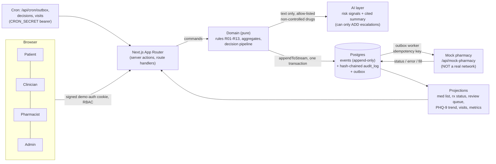

# CareLoop

> **ALL DATA IS SYNTHETIC.** CareLoop is a portfolio demo. It handles no real patients, sends nothing
> to a real pharmacy and makes no clinical or compliance claims. Design stance: **HIPAA-aligned design,
> synthetic data.**

CareLoop is a demo of an AI-assisted psychiatric prescription-renewal loop, modeled on the public
protocol of Legion Health's Utah AI pilot (see [docs/sources.md](docs/sources.md) for the source list).
A patient on a stable, existing, non-controlled medication asks for a refill and does a short check-in.
Deterministic rules plus an LLM that can only add risk signals either auto-renew (depending on the
autonomy mode) or escalate to a human clinician. A mock pharmacy answers with NCPDP-SCRIPT-style
messages, and hitting the refill limit forces a follow-up visit.

## What CareLoop is, and is not

It is:

- A worked example of event sourcing, a hash-chained audit log, a transactional outbox, deterministic
  clinical rules kept separate from an LLM, fail-closed AI handling, and an eval harness.
- Four role-based apps (patient, clinician, pharmacist, admin) behind a signed-cookie demo login.
- Fully runnable locally with Docker (Postgres) and no API keys: without `ANTHROPIC_API_KEY` the AI path
  fails closed and renewals escalate to a clinician.

It is not:

- Not a medical device, not clinical software, not validated for any clinical use. It is not
  "clinically validated" and no sensitivity or specificity is claimed anywhere.
- Not compliant with, or certified under, any regulation or program. "HIPAA-aligned design, synthetic data"
  is the only wording used. There is no real e-prescribing network, no EPCS, no real PHI.
- Not real authentication: the login is a role switcher for demonstration (see
  [Security posture](#security-posture)).
- Not tested against any live service. The Anthropic API, Langfuse and a real Supabase pooler have
  never been used by this repo; every eval fixture is hand-written.

## Architecture



Key properties, each enforced by tests (details in [docs/HANDOFF.md](docs/HANDOFF.md) section 2):

- The `events` table is append-only (database triggers) and written only through `appendToStream`, which
  also appends the audit entry and any outbox rows in the same transaction. All state is a projection.
- Clinical decisions live in `src/domain/rules` as pure, deterministic functions. The LLM may only add
  escalation signals; it can never approve or override a rule.
- Fail closed: an LLM error, timeout or schema-invalid output means escalate.
- Controlled substances never enter the AI path (a positive allow-list gate, with proof tests) and are
  never transmitted.
- Every external call takes an idempotency key; side effects go through the outbox; every write appends
  to the hash-chained audit log (`pnpm audit:verify` recomputes the chain).

Stack: Next.js 15 App Router, TypeScript strict, Tailwind, Postgres with Drizzle (hand-rolled event
store on postgres.js), Zod at every boundary, Vitest, Playwright, `@anthropic-ai/sdk`, pnpm.

## Run it

Prerequisites: Node 20 or newer, pnpm 12 (pinned by `packageManager`), Docker, and Git Bash on Windows.

```bash
docker compose up -d --wait db     # Postgres 16 on localhost:54329
set -a; . ./.env.example; set +a   # load the synthetic template values into this shell
pnpm install
pnpm db:migrate                    # applies the drizzle/ migrations
pnpm db:seed                       # deterministic synthetic data (SEED=42), idempotent
pnpm dev                           # http://localhost:3000, role switcher at /login
```

`./init.sh` does install, migrate, seed and starts the dev server in the background. Never create or
edit a real `.env` for the demo: `.env.example` holds template values only and no secrets.

If the AI path has no key (the default), the decision pipeline fails closed and renewals escalate, which
is the correct and safe behaviour. To try the model path, set `ANTHROPIC_API_KEY` and `ANTHROPIC_MODEL`
yourself; that path has never been exercised against the real API by this repo.

### Environment variables

`.env.example` is the template (placeholders only, no secrets). Never create or commit a real `.env`.

| Variable                                                                            | Purpose                                                                                                                                      |
| ----------------------------------------------------------------------------------- | -------------------------------------------------------------------------------------------------------------------------------------------- |
| `DATABASE_URL`                                                                      | Postgres connection string (default matches docker-compose; use the Supabase pooler URL when deployed)                                       |
| `SESSION_SECRET`                                                                    | Signs the demo-auth cookie; at least 32 characters. In production the `.env.example` placeholder is refused and sessions fail closed         |
| `DEMO_AUTH_ENABLED`                                                                 | Production only: the role switcher works only when this is exactly `true` (default deny)                                                     |
| `CRON_SECRET`                                                                       | Bearer secret for `/api/cron/*`; unset means those routes return 401. Vercel Cron sends it automatically as `Authorization: Bearer <value>`  |
| `ANTHROPIC_API_KEY`, `ANTHROPIC_MODEL`                                              | Enable the live AI path; empty means fixtures only and the AI path fails closed                                                              |
| `LANGFUSE_PUBLIC_KEY`, `LANGFUSE_SECRET_KEY`, `LANGFUSE_HOST`, `RESEND_API_KEY`     | Optional tracing and email, skipped when unset                                                                                               |
| `REFILL_LIMIT`, `SAMPLE_RATE`, `SEED`                                               | Business config (refill limit, retrospective sampling share, deterministic seed)                                                             |
| `PHARMACY_STALE_HOURS`                                                              | Hours before an accepted but unfilled renewal is flagged as stalled (default 72; a demo value, TODO: source needed)                          |
| `NEXT_DIST_DIR`                                                                     | Alternate Next build directory so parallel dev servers and e2e runs do not share a cache                                                     |
| `LOGIN_RATE_LIMIT_PER_MIN`, `CSP_REPORT_ONLY`                                       | Optional hardening knobs: login budget per IP (default 20; e2e only) and shipping the CSP as report-only                                     |
| `MOCK_PHARMACY_FORCE`, `RISK_FIXTURE`, `SUMMARY_FIXTURE`, `VISIT_CLOCK_OFFSET_DAYS` | Dev and test only, **never set in production**: scripted e2e behaviour. Each is ignored unless `NODE_ENV` is exactly `development` or `test` |

## Security posture

HIPAA-aligned design, synthetic data. This is a demo, not a hardened production system.

- Demo auth: a role switcher issues an HMAC-signed, httpOnly cookie. Anyone can pick any role, so it is
  labelled "demo auth" in the UI. In a production build it is off unless `DEMO_AUTH_ENABLED=true`; with
  it off, `/login` shows a disabled notice and no demo cookie is honoured. RBAC is enforced server-side.
- Production guards (fail closed): a missing, short or `.env.example`-placeholder `SESSION_SECRET` makes
  every session invalid and the switcher refuses to mint one. The dev and test switches above are ignored.
- Security headers on every path: Content-Security-Policy (script-src needs `'unsafe-inline'` because the
  App Router emits inline bootstrap scripts without a nonce middleware; everything else is locked down,
  `frame-ancestors 'none'`), X-Frame-Options, X-Content-Type-Options, Referrer-Policy, Permissions-Policy,
  HSTS in production, no `X-Powered-By`.
- Rate limits: `/api/mock-pharmacy` (120 per minute per IP), the three cron routes (30 per minute, applied
  before the secret check) and the login action (20 per minute). They are in-memory and **per instance,
  best effort**: each serverless instance counts separately and a cold start resets the counters.
- Known remaining gaps are listed under Known limitations and in [docs/DECISIONS.md](docs/DECISIONS.md).

## Deploying to Vercel (not deployed by this repo)

Nothing in this repo deploys itself and no deployment was made. If you deploy it yourself:

1. Create a Postgres database (for example Supabase) and run `pnpm db:migrate` and `pnpm db:seed` against it
   from your machine. Set `DATABASE_URL` in the Vercel project.
2. Set `SESSION_SECRET` (long random string), `CRON_SECRET` (long random string) and, only if you accept
   that anyone can pick a role, `DEMO_AUTH_ENABLED=true`. Add `ANTHROPIC_API_KEY` and `ANTHROPIC_MODEL`
   only if you want the live AI path (untested by this repo); without them renewals escalate.
3. `vercel.json` registers three crons: `/api/cron/outbox`, `/api/cron/decisions` and `/api/cron/visits`.
   When `CRON_SECRET` is set, Vercel Cron sends `Authorization: Bearer <CRON_SECRET>` automatically; each
   route returns 401 without it. The committed schedules are once a day (05:00, 05:10 and 05:20 UTC)
   because Hobby plans only allow daily cron jobs and a more frequent expression fails the deployment.
   On a Pro plan change them in `vercel.json` to something like `* * * * *` for the outbox,
   `*/5 * * * *` for decisions and `*/15 * * * *` for visits. With daily crons the outbox drains rarely;
   the check-in action still evaluates a renewal immediately, but pharmacy transmission waits for the
   next cron, or for any scheduler you point at the route with the bearer secret.
4. `next.config.ts` sets the security headers and `outputFileTracingIncludes` so `/admin/evals` can read
   `evals/results/*.json` from the serverless bundle.

Supabase pooler notes: use the transaction-mode pooler URL. The client sets `prepare: false` (prepared
statements are not supported in transaction mode) and a small pool. The app uses no LISTEN/NOTIFY and no
session-level advisory locks; the event store serialises appends with a row lock inside one transaction,
which is pooler safe. Run migrations over a direct or session connection. This has not been tried
against a real Supabase pooler.

## Session ritual (how this repo is built)

The repo is built by Claude Code agents following [CLAUDE.md](CLAUDE.md). Every session:

1. Read `claude-progress.md`, `git log --oneline -20` and `feature_list.json`.
2. Run `./init.sh`, then `pnpm test`. If the baseline is red, fix that first.
3. Pick the highest-priority feature with `"passes": false` and build only that one.
4. Verify it end to end (unit tests plus Playwright where there is UI). Only then set `"passes": true`.
5. Commit with a descriptive message and append a dated entry to `claude-progress.md`.

## Commands

| Command                     | What it does                                                                    |
| --------------------------- | ------------------------------------------------------------------------------- |
| `pnpm dev`                  | Next.js dev server                                                              |
| `pnpm build` / `pnpm start` | Production build and server                                                     |
| `pnpm test`                 | Vitest (needs Postgres; each file gets an isolated schema)                      |
| `pnpm e2e`                  | Playwright; many specs are env-gated and skip silently, see each spec header    |
| `pnpm eval`                 | Eval harness in fixtures mode; fails on regressions and writes `evals/results/` |
| `pnpm eval:live`            | Same cases against the real API; implemented but never run (needs your own key) |
| `pnpm eval:pins`            | Regenerate the sha256 pins for required eval cases (a reviewed act)             |
| `pnpm db:migrate`           | Apply migrations                                                                |
| `pnpm db:seed`              | Seed synthetic data                                                             |
| `pnpm projections:rebuild`  | Rebuild every projection from position 0                                        |
| `pnpm audit:verify`         | Recompute the audit hash chain (exit 0 intact, 1 tampered, 2 error)             |
| `pnpm outbox:work`          | Run the outbox worker (`-- --once` for a single pass)                           |
| `pnpm typecheck`            | `tsc --noEmit`                                                                  |
| `pnpm lint`                 | ESLint                                                                          |
| `pnpm format:check`         | Prettier check (CI runs it)                                                     |

## Multi-agent verification workflow

Builders work on disjoint paths. Every feature is then run by an independent `verifier` subagent that
executes the feature's listed verification and edits nothing. Any change to rules, AI, escalation or
autonomy additionally goes to a fresh `clinical-safety-reviewer` with no memory of earlier rounds, which
writes adversarial tests and reports exact failing inputs. A FAIL goes back to the builder and then to
another fresh reviewer; a `passes` flag flips only after a PASS and a clean re-run of the listed
verification. Defects this process caught (each fixed with tests) include a mislabelled controlled drug
reaching auto-eligibility, an emoji before risk text silencing the tripwire, a rejection swallowing
suicidality, and a system approval completing an escalated renewal. See
[docs/HANDOFF.md](docs/HANDOFF.md) section 6 and [docs/AI_AGENTS.md](docs/AI_AGENTS.md).

## Evaluation results

Regenerate this block with `pnpm exec tsx scripts/readme-results.ts` after `pnpm eval`; a test fails if
it drifts from `evals/results/latest.json`.

<!-- eval-results:start -->

| Metric                                 | Value                                                                                            |
| -------------------------------------- | ------------------------------------------------------------------------------------------------ |
| Run mode                               | fixtures (fixtures: synthetic-handwritten)                                                       |
| Live model run                         | no                                                                                               |
| Cases                                  | 153                                                                                              |
| Risk cases                             | 88                                                                                               |
| Cases that exercise the AI path        | 98                                                                                               |
| Cases labelled ESCALATE                | 113                                                                                              |
| Escalation recall (gated set)          | 100.0%                                                                                           |
| Unsafe approvals                       | 0                                                                                                |
| Auto-approve precision                 | 100.0%                                                                                           |
| Outcome accuracy                       | 100.0%                                                                                           |
| Reason-code accuracy                   | 100.0%                                                                                           |
| Citation validity                      | 100.0%                                                                                           |
| AI-blocked cases / LLM calls on them   | 6 / 0                                                                                            |
| Known-limitation probes (not gated)    | 3 probes the system still misses                                                                 |
| Escalation recall including the probes | 97.4% (3 missed of 116 SPEC-labelled escalations)                                                |
| Summary judge (fixture judgments)      | 15 cases, 8 judged, 7 fail-closed; hallucinations 3 major / 1 minor, omissions 4 major / 1 minor |
| Gate                                   | pass                                                                                             |

Source: `evals/results/latest.json` (generated by `evals/run.eval.ts@1.1.0`). These are FIXTURE results: every model answer is a hand-written canned response, no live model or live judge has ever run, so the numbers show how the pipeline handles those responses, not how any real model performs. Recall of 100% is over the gated set only; the probes row is the honest figure.
<!-- eval-results:end -->

## Known limitations

- **The evals are fixture-based.** Every model answer is a hand-written canned response and the summary
  judge is a fixture judge. No live model, live judge, Langfuse instance or real Supabase pooler has ever
  been used. Results demonstrate behaviour and regressions of this pipeline, not model performance.
- **Eval cases are small, synthetic and hand-labelled** from the SPEC; they are not clinical validation.
  Some labels rest on implementation choices (listed in [docs/MODEL_CARD.md](docs/MODEL_CARD.md)).
- **Known-limitation probes still fail.** `evals/known-limitations/` holds SPEC-labelled escalations the
  system misses when the model is silent (free-text mania, severe side effects and admitted dishonest
  PHQ-9 answers, in wordings the phrase lists do not cover; the count is in the results table). Recall over the gated set is 100%;
  the honest figure including the probes is in the results table. In the default SHADOW autonomy mode a
  clinician approves every renewal; in RETRO and SAMPLED modes a model miss on such wording would be sent
  automatically. An owner decision is needed before enabling those modes anywhere real.
- **The tripwire and the summary deny-list are heuristics**: small English-only lexicons, deliberately
  over-inclusive, not clinically reviewed, with documented misses.
- **Demo auth is a role switcher**, not authentication. The app database role still has UPDATE and
  DELETE on `events` (append-only is enforced by triggers a superuser could disable).
- **Real gaps stay marked `TODO: source needed`** (hydroxyzine numeric limits, mirtazapine monitoring
  interval, follow-up gap, stall thresholds, and others); see [docs/DECISIONS.md](docs/DECISIONS.md).
- The 98% concurrence figure from public reporting appears only as a labelled TARGET, never as a result.

## Documentation

- [docs/SPEC.md](docs/SPEC.md): the product spec and rule list (user-owned input).
- [docs/sources.md](docs/sources.md): every external source used (user-owned input).
- [docs/DECISIONS.md](docs/DECISIONS.md): architecture decisions, amendments and known gaps.
- [docs/STANDARDS.md](docs/STANDARDS.md): which public vocabularies are mirrored and how.
- [docs/MODEL_CARD.md](docs/MODEL_CARD.md): intended use, safety design, evaluation, limitations.
- [docs/AI_AGENTS.md](docs/AI_AGENTS.md): runtime AI and the development agent harness.
- [docs/HANDOFF.md](docs/HANDOFF.md): status, run and verification detail, gotchas.
- [CHANGELOG.md](CHANGELOG.md) and [claude-progress.md](claude-progress.md): release notes and the session log.

## License

MIT, see [LICENSE](LICENSE).
